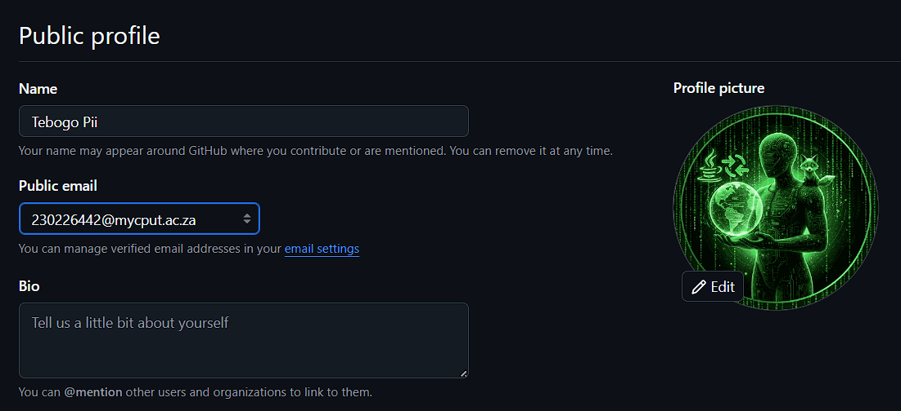
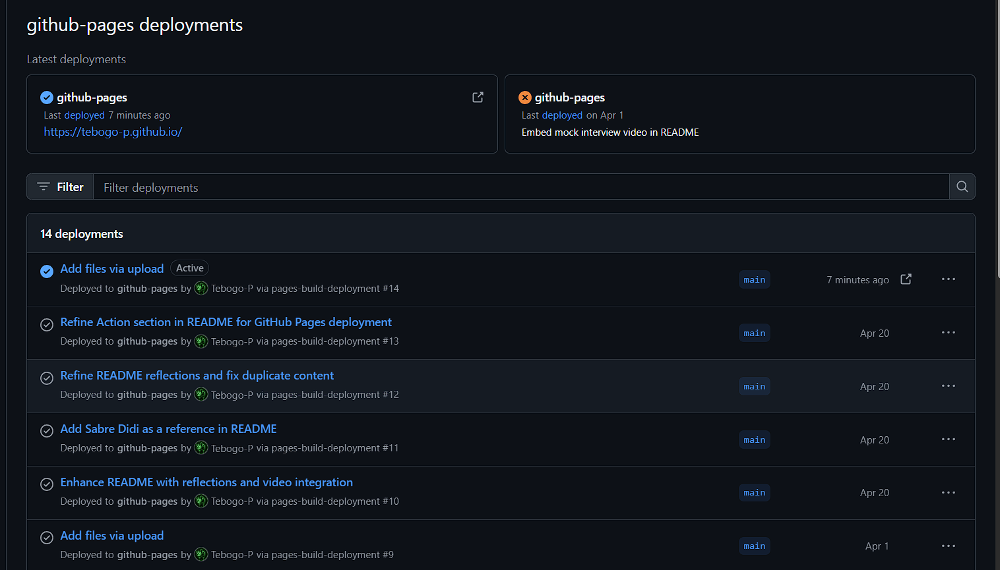
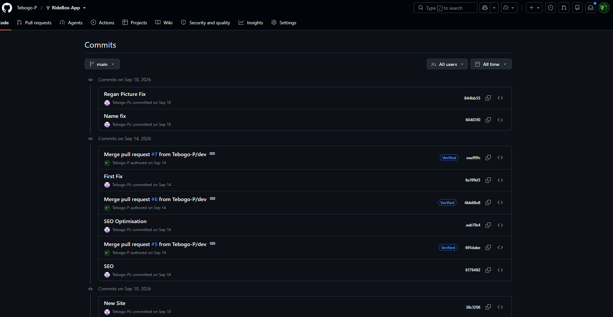
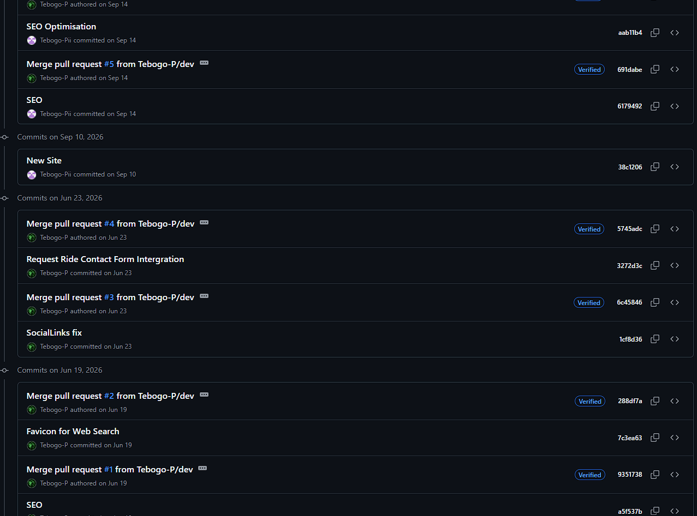

# Digital-Portfolio
 
# Markdown-CV
 
# Tebogo Pii
**STUDENT**
 
As a passionate and dedicated ICT student, I am seeking an IT-related internship opportunity or entry-level position to apply my academic knowledge, strengthen my technical skills, and contribute to innovative solutions. My goal is to gain hands-on experience in application development, databases, cybersecurity, and IT systems to grow as a professional in the technology field. My main language is Java and its framework SpringBoot.
 
## Contact
* **Email:** 230226442@mycput.ac.za
* **Phone Number:** 067 120 7297
* **LinkedIn:** Tebogo Pii
* **GitHub:** Tebogo-P
* **Address:** Woodstock, Cape Town
## Education
* **Cape Peninsula University of Technology:**
  * Diploma in ICT: Application Development (2024 - 2026)
  * HC in ICT (2023)
* **Mosupatsela SS:** Matriculation (2022)
## Skills
* **Tools & IDEs:** VS Code, IntelliJ, Eclipse, NetBeans, MySQL Workbench, Git/GitHub, Figma, Google Antigravity.
* **Professional:** Agile Project Management (Trello), Team Collaboration, Problem Solving, MS Teams, Google IT Support Professional Certificate (Specialization in Networking & IT Security).
* **Technical:** Database Foundations, Big Data in the Age of Al, Learning GitHub.
* **Security & Compliance:** Application Security, IT Security Foundations, Data Privacy.
* **Management:** Project Management Skills for Leaders, Data-Driven Decision Making.
## Projects
### Student Enrolment App (2025)
* Developed a client-server desktop application using Java Swing to manage student records. Posted on GitHub.
* Implemented server-side logic to handle data requests and streamlined the GUI for better UX.
* Tech: Java, Swing, NetBeans.
### Student Residences App (2025)
* Built a desktop application to manage residence information and student placements. Posted on GitHub.
* Integrated a local Apache Derby database via JDBC for persistent data storage.
* Wrote optimized SQL queries for data retrieval and management.
* Tech: Java, JDBC, SQL, Apache Derby.
### NGO Website & Web Portfolio (2025)
* Collaborated in a team to design and deploy a responsive website for a non-profit organization. Posted on GitHub.
* Developed a personal portfolio using HTML5, CSS3, and JavaScript to showcase technical projects.
* Applied responsive design principles to ensure compatibility across mobile and desktop devices.
* Tech: HTML5, CSS3, JavaScript, Visual Studio Code.
## References
* **Kruben Naidoo**
  * Lecturer
  * naidoo@cput.ac.za
* **Sabre Didi**
  * Lecturer
  * didis@cput.ac.za
---
 
# Work Readiness Portfolio
 
---
 
## 1. GitHub Student Account
 
**Evidence:**
 

 
---
 
## 2. CV Coded in Markdown
 
**Evidence:** The CV above is written entirely in Markdown. View the raw source: [README.md](README.md)
 
---
 
## 3. Reflection: Coding in Markdown
**Situation:** As part of building our work readiness portfolio, I needed to code my professional CV using Markdown language.
 
**Task:** The goal was to translate my academic history at CPUT and my technical capabilities into a clean, version-controllable, plain-text format.
 
**Action:** For this work, I had to focus solely on lightweight markup syntax, even though my daily coding generally requires configuring Java and Spring Boot backends. The Subject Guide, which offered a thorough syntax breakdown was quite beneficial in this situation. I built organized unordered lists for my talents and correctly formatted headers for my projects using the examples in the guide.
 
**Result:** I was able to create a really readable CV using only Markdown. The formatting procedure was made considerably quicker by the subject guide's introduction of GitHub Flavored Markdown, which strengthened my documentation abilities and will undoubtedly be useful for the README files in my upcoming enterprise projects.
 
---
 
## 4. Mock Interview Video
 
**Evidence:**
 
<video width="640" controls>
  <source src="Interview.mp4" type="video/mp4">
</video>
---
 
## 5. Reflection: Mock Interview Video
**Situation:** To prepare for entering the professional IT industry we needed to simulate a real-world job interview environment.
 
**Task:** I had to record a mock interview video demonstrating my professional communication skills and then embed it into the digital portfolio.
 
**Action:** I tried my best to develop replies using the STAR technique principles we learned in class. The subject guide was essential to my preparation because it made it clear that the video had to be shot against a plain background and last no more than two minutes. In order to organize my spoken answers, I also paid great attention to the guide's visual explanation of the STAR approach. In order to make sure I looked the part, the advisor also advised me to dress physically for the interview.
 
**Result:** The recording was professional, clear, and successfully integrated into my Markdown document. My confidence in expressing my problem-solving skills significantly increased as I relied on the guide's examples of behavioral and technical questions.
 
---
 
## 6. Published on GitHub Pages
 
**Evidence:**
 

 
Live site: [https://tebogo-p.github.io/](https://tebogo-p.github.io/)
 
---
 
## 7. Reflection: The Use of GitHub Pages
**Situation:** Once the Markdown CV and interview video were compiled, the portfolio needed to be made publicly accessible for grading.
 
**Task:** I had to deploy my local repository to the web using the GitHub Pages hosting service.
 
**Action:** I had previously worked with hosting on GitHub Pages, so the instruction served as a kind of recap of what I already knew. I had to set up the deployment after I committed my finished code. I followed the subject guide's visual, step by step instructions exactly. I was able to access the "Pages" portion in the sidebar, navigate to the repository settings, and set up the build to deploy from my main branch thanks to the guide.
 
**Result:** The portfolio is currently operational after a flawless deployment. I had a firm grasp of how to host static sites for my next project thanks to the guide's detailed directions, which removed any uncertainty from the process.

# RideBox Digital Portfolio: Work-Integrated Learning

> **Submission note:** Replace the bracketed personal details and evidence links before submitting. This portfolio is written from the RideBox repository and its Git history; it does not invent Trello activity or personal information that is not present in the repository.

| Student | Tebogo Pii |
|---|---|
| Student number | 230226442 |
| Qualification | Diploma in Information and Communication Technology |
| Subject | Project Presentation 3 (PRP370S / PRP371S / PRP372S) |
| Company/project | RideBox Technologies |
| Role | Web developer and UI/UX contributor |
| Repository | [Tebogo-P/RideBox-App](https://github.com/Tebogo-P/RideBox-App) |
| Live website | [rideboxapp.com](https://www.rideboxapp.com) |
| Design artefact | [RideBox Figma design](https://www.figma.com/file/mhBGX4VZ2vGjDRCFH4rTDl?node-id=1-1031&t=N5XllcbgBtweBV45-0&type=design&mode=design&fuid=1673636267097669421) |

## Introduction and portfolio purpose

This e-portfolio collects, selects, reflects on, and connects evidence from my work on the RideBox web platform. RideBox is a pre-launch concept for solar-assisted self-service kiosks that connect commuters to licensed e-hailing services without requiring a personal smartphone or data bundle. My work with RideBox has been great and educational and It helped me grow as a Web Developer.

The portfolio follows the four evidence practices in the assessment brief:

1. **Collect:** source files, deployed pages, design work, and Git commits.
2. **Select:** evidence that demonstrates planning, implementation, iteration, and learning.
3. **Reflect:** structured explanations of what I learned and what I would improve.
4. **Connect:** links between the Agile artefacts and the final website.

The current application is a React/Vite single-page application with React Router, Tailwind utility classes, `react-helmet-async`, responsive layouts, kiosk concept imagery, service/FAQ content, team information, and a contact flow.

## 1. Agile Team Charter

### Evidence

**Shared purpose:** Build and publish a clear, accessible, mobile-responsive website that explains the RideBox kiosk concept and gives riders, site hosts, advertisers, and e-hailing operators a way to understand the offering and make contact.

**My responsibilities:**

- Translate the RideBox concept into a navigable web experience.
- Turn the visual direction in Figma into reusable React page and navigation structures.
- Present the kiosk concept, technical specifications, services, FAQ content, team, and contact options.
- Improve discoverability through page titles, descriptions, robots instructions, and a sitemap.
- Use GitHub commits to record changes and correct issues discovered during review.
- Hosting and maintaining the site.

**Values and working agreements:**

| Agreement | How it was applied |
|---|---|
| User-first communication | Content is organised around rider, driver, host, advertiser, and operator questions in [`Services.jsx`](https://github.com/Tebogo-P/RideBox-App/blob/main/src/pages/Services.jsx). |
| Design before implementation | The Figma design is retained as the visual reference for the website direction. |
| Reusable implementation | Shared [`Navbar.jsx`](https://github.com/Tebogo-P/RideBox-App/blob/main/src/components/Navbar.jsx) and [`Footer.jsx`](https://github.com/Tebogo-P/RideBox-App/blob/main/src/components/Footer.jsx) are used around routed pages. |
| Responsive delivery | Layouts use mobile-first responsive breakpoints and are adjusted in commits such as [Mobile Responsiveness Update](https://github.com/Tebogo-P/RideBox-App/commit/db5a6df75e89cd3c0029e1bb12483360800bcb34). |
| Traceable changes | Features and corrections are recorded in the [repository commit history](https://github.com/Tebogo-P/RideBox-App/commits/main). |

### Reflection

The project was given a practical boundary by the charter, which said that the product should be communicated honestly, the interface should remain useable on small screens, and changes should be recorded rather than depending on undocumented edits. I was tackling issues alone at first but i learned to ask for help as time went on. Due to RideBox's pre-launch status, this was particularly crucial. As a result, the website makes a distinction between suggested kiosk features and existing capabilities. For instance, it states that the first unit is still being prepared and describes the hardware as a concept. I discovered that when a product isn't yet functional, a distinct content boundary is just as crucial as esthetic polish. Working on this project really helped me grasp how things are done professionally.

## 2. User Stories and Tasks

### Evidence

#### User story 1: Understand the RideBox concept

> **As a** visitor, **I want to** understand what RideBox is and who it serves, **so that** I can decide whether to explore the kiosk, services, or contact options.

**Tasks and evidence:**

- [x] Build the home route with the value proposition, calls to action, kiosk preview, advertising, services, and mission sections in [`Home.jsx`](https://github.com/Tebogo-P/RideBox-App/blob/main/src/pages/Home.jsx).
- [x] Add routes for Home, Kiosk, About, Services, Team, Contact, Legal, and a not-found page in [`App.jsx`](https://github.com/Tebogo-P/RideBox-App/blob/main/src/App.jsx).
- [x] Add descriptive page titles and metadata using `Helmet`.

#### User story 2: Inspect the kiosk concept

> **As a** potential site host or partner, **I want to** see the proposed kiosk and its specifications, **so that** I can understand the concept before discussing deployment.

**Tasks and evidence:**

- [x] Show front and back kiosk concept renders in [`Kiosk.jsx`](https://github.com/Tebogo-P/RideBox-App/blob/main/src/pages/Kiosk.jsx).
- [x] Present power, connectivity, language, operator, safety, and resilience information as technical specification cards.
- [x] Add the kiosk images and related assets in [`public/`](https://github.com/Tebogo-P/RideBox-App/tree/main/public).
- [x] Add kiosk imagery in the [kiosk images commit](https://github.com/Tebogo-P/RideBox-App/commit/5d9274abf290c3b9357e199d6eaed78532856c0).

#### User story 3: Find a relevant service or answer

> **As a** rider, driver, advertiser, host, or e-hailing operator, **I want to** find information relevant to me, **so that** I can make an informed enquiry.

**Tasks and evidence:**

- [x] Create service descriptions for e-hailing access, advertising, secure booking, power resilience, drivers, and site hosting in [`Services.jsx`](https://github.com/Tebogo-P/RideBox-App/blob/main/src/pages/Services.jsx).
- [x] Add grouped FAQ interactions for riders, drivers, partners, and general questions.
- [x] State clearly that the first kiosk is not yet operating and that the product is in preparation.

#### User story 4: Make contact

> **As a** visitor, **I want to** send a partnership, advertising, hosting, operator, or general enquiry, **so that** I can contact the RideBox team without needing a separate form service.

**Tasks and evidence:**

- [x] Add required name, email, and message fields in [`Contact.jsx`](https://github.com/Tebogo-P/RideBox-App/blob/main/src/pages/Contact.jsx).
- [x] Add inquiry categories including Host a Kiosk, Advertising, and E-Hailing Operator.
- [x] Build a `mailto` subject and message body from the submitted form data.
- [x] Add submission feedback and contact metadata.
- [x] Record the contact integration in [Request Ride Contact Form Integration](https://github.com/Tebogo-P/RideBox-App/commit/3272d3c75e7d6f588e6588e73c70cfef4720e38f).

### Reflection

I was able to relate each page to a real audience need by writing the stories before explaining the execution. Separating the product audiences a rider needs access and safety information, while a host or operator needs partnership information was the most beneficial shift in my way of thinking. That distinction is reflected in the inquiry and FAQ categories. I also learnt how to appropriately explain the real behavior: it is not a server-side form submission; rather, the form opens the visitor's email application via mailto. Thinking as an end-user helped me pitch how the design of the site should be based off how i think users will interact with it.

## 3. Trello

### Evidence

The workplace project did not use Trello as an official project-management tool. I will therefore create a personal retrospective Trello board based on my actual RideBox activities, Git commits, Figma work, testing, and deployed website evidence. This board will be submitted as an individual reconstruction for assessment purposes; it is not presented as the company's official board.

**Evidence to add before submission:**

- **Trello board:** [RideBox Technologies personal retrospective board](https://trello.com/invite/b/6ae1a69f7b6d92fb6dbb4e82/ATTIe1161c8ff304f4d5615b73e11aaf1c9c14AC915F/ridebox-technologies)
- **Board screenshot/export:**

  

The board will contain lists such as **Backlog**, **To Do**, **In Progress**, **Review/Testing**, **Done**, and **Blocked/Future Improvements**. Cards will correspond only to work supported by the evidence in this portfolio, including the Figma designs, implementation commits, responsive improvements, SEO work, contact flow, deployment, and screenshots. Cards will not be backdated or presented as official workplace activity.

### Reflection

There is no official workplace Trello board to submit because Trello was not used in the project-management process. While the personal retrospective board will offer a visual representation of planning, progress, review, and finished work for evaluation, Git documents the project's technical history. I'll identify it as a retrospective reconstruction and utilize it to link each card to actual commits, screenshots, design artifacts, and the live website. Because it doesn't assert that Trello was used at work or create project activities, this method is transparent. 

## 4. Product Backlog

### Evidence

| ID | Priority | Product backlog item | Evidence/acceptance criterion | Status |
|---|---|---|---|---|
| PB-01 | High | Establish React/Vite application structure | Routed pages load through [`App.jsx`](https://github.com/Tebogo-P/RideBox-App/blob/main/src/App.jsx). | Done |
| PB-02 | High | Create responsive navigation and site shell | Shared navbar/footer render across routes. | Done |
| PB-03 | High | Explain the RideBox concept on the home page | Home page contains value proposition, kiosk preview, services, and mission content. | Done |
| PB-04 | High | Present kiosk concept and technical details | Front/back renders and specification cards appear on the Kiosk page. | Done |
| PB-05 | High | Add services and FAQ information | Six services and grouped FAQs are available on the Services page. | Done |
| PB-06 | High | Add contact and inquiry flow | Contact form builds an email subject/body and gives feedback. | Done |
| PB-07 | Medium | Add SEO and discoverability metadata | Page metadata, [`robots.txt`](https://github.com/Tebogo-P/RideBox-App/blob/main/public/robots.txt), and [`sitemap.xml`](https://github.com/Tebogo-P/RideBox-App/blob/main/public/sitemap.xml) are present. | Done |
| PB-08 | Medium | Improve responsive behaviour | Mobile and tablet layout corrections are recorded in Git history. | Done |
| PB-09 | Medium | Correct content and asset issues | Team name/photo corrections are recorded in [Name fix](https://github.com/Tebogo-P/RideBox-App/commit/60403f035665fe7b8cbc168368164bfaf5affefd0) and [Regan Picture Fix](https://github.com/Tebogo-P/RideBox-App/commit/844bb557efa0ea4f7e70bbc72de64a57096798d0). | Done |

### Reflection

I prioritized the backlog according to dependencies: the core pages had to be accessible before SEO and refinement work could be examined, and the application shell and navigation had to exist before the content pages could be connected. The commit history demonstrates that responsive modifications, contact integration, SEO enhancements, and content edits were made after the first implementation. The remaining evidence task is to attach the Trello and GitHub Pages proof that the assessment requires; it is not a code feature.

## 5. Sprint Backlog

### Evidence: homepage and platform sprint

**Sprint goal:** Deliver a navigable, responsive RideBox website that communicates the concept and supports enquiries.

| Sprint task | Output/evidence | Completion |
|---|---|---|
| Review the visual direction | [Figma design artefact](https://www.figma.com/file/mhBGX4VZ2vGjDRCFH4rTDl?node-id=1-1031&t=N5XllcbgBtweBV45-0&type=design&mode=design&fuid=1673636267097669421) | Done |
| Build the React/Vite shell | [`App.jsx`](https://github.com/Tebogo-P/RideBox-App/blob/main/src/App.jsx), [`Navbar.jsx`](https://github.com/Tebogo-P/RideBox-App/blob/main/src/components/Navbar.jsx), and [`Footer.jsx`](https://github.com/Tebogo-P/RideBox-App/blob/main/src/components/Footer.jsx) | Done |
| Assemble the home experience | [`Home.jsx`](https://github.com/Tebogo-P/RideBox-App/blob/main/src/pages/Home.jsx) | Done |
| Add platform pages | [`Kiosk.jsx`](https://github.com/Tebogo-P/RideBox-App/blob/main/src/pages/Kiosk.jsx), [`Services.jsx`](https://github.com/Tebogo-P/RideBox-App/blob/main/src/pages/Services.jsx), [`About.jsx`](https://github.com/Tebogo-P/RideBox-App/blob/main/src/pages/About.jsx), and [`Team.jsx`](https://github.com/Tebogo-P/RideBox-App/blob/main/src/pages/Team.jsx) | Done |
| Add enquiry flow | [`Contact.jsx`](https://github.com/Tebogo-P/RideBox-App/blob/main/src/pages/Contact.jsx) | Done |
| Improve metadata and search discovery | [SEO Optimisation commit](https://github.com/Tebogo-P/RideBox-App/commit/aab11b4d427ce89681816586d51578b9f2de407e) | Done |
| Check responsive layouts and fix content/assets | [Mobile Responsiveness Update](https://github.com/Tebogo-P/RideBox-App/commit/db5a6df75e89cd3c0029e1bb12483360800bcb34), [Name fix](https://github.com/Tebogo-P/RideBox-App/commit/60403f035665fe7b8cbc168368164bfaf5affefd0) | Done |

### Reflection

Since each work resulted in a visible increment, the sprint format made managing a huge website easier. One important lesson was that implementation is not complete when the website first loads; the quality of the deliverable is also impacted by responsive spacing, metadata, text accuracy, and picture naming. This cycle of refining is obvious in the next commits. Before declaring a job finished, I would take screenshots at each breakpoint and include a formal acceptance checklist in a subsequent sprint.

## 6. Agile Logbook

### Evidence: dated Git activity

The Git history provides a verifiable project log:

| Date | Commit/evidence | Activity and learning |
|---|---|---|
| 25–26 March 2026 | [Initial uploads and Code Redesign](https://github.com/Tebogo-P/RideBox-App/commit/30a7f15566eb108ae8b45725d74ac3c19daac60) | Moved from uploaded/prototype material toward a redesigned web implementation. |
| 7 April 2026 | [Initial React application](https://github.com/Tebogo-P/RideBox-App/commit/b997837) | Established the application codebase and began productionising the site. |
| 7 April 2026 | [Formspree functionality](https://github.com/Tebogo-P/RideBox-App/commit/dc29057f75e89cd3c0029e1bb12483360800bcb34) | Investigated and integrated a contact approach while refining the site shell. |
| 15 April 2026 | [Kiosk images](https://github.com/Tebogo-P/RideBox-App/commit/5d9274abf290c3b9357e199d6eaed78532856c0) | Added visual hardware evidence to communicate the kiosk concept. |
| 13 May 2026 | [Contact form action URL](https://github.com/Tebogo-P/RideBox-App/commit/f5796527968c119fc4a79db167557c8d7395c20d) | Corrected the contact destination as part of deployment refinement. |
| 23 June 2026 | [Contact form integration](https://github.com/Tebogo-P/RideBox-App/commit/3272d3c75e7d6f588e6588e73c70cfef4720e38f) | Added the request/contact flow used by the current site. |
| 14 September 2026 | [SEO Optimisation](https://github.com/Tebogo-P/RideBox-App/commit/aab11b4d427ce89681816586d51578b9f2de407e) | Added and refined page metadata and discoverability support. |
| 18 September 2026 | [Name fix](https://github.com/Tebogo-P/RideBox-App/commit/60403f035665fe7b8cbc168368164bfaf5affefd0) and [Regan Picture Fix](https://github.com/Tebogo-P/RideBox-App/commit/844bb557efa0ea4f7e70bbc72de64a57096798d0) | Corrected visible content and an asset filename after review. |

### Stand-up-style log entries

1. **Plan:** establish the React structure and translate the visual concept into a navigable site. **Blocker:** the original material did not yet provide a complete production page structure. **Action:** organise the application into routed pages and shared components.
2. **Plan:** add the kiosk and service content. **Blocker:** the hardware is a concept, not a deployed product. **Action:** label renders and specifications as proposed/pre-launch information.
3. **Plan:** make the site useful to several audiences. **Blocker:** a single generic contact path would not distinguish different enquiries. **Action:** add inquiry categories and audience-specific FAQ groups.
4. **Plan:** prepare the site for public discovery. **Blocker:** pages need distinct search metadata and crawl support. **Action:** update titles/descriptions and add robots/sitemap support.
5. **Plan:** polish the final evidence. **Blocker:** Trello and GitHub Pages proof are not present in this repository. **Action:** add the board URL, screenshots, and final published URL before submission.

### Retrospective reflection

**What went well:** The project moved from a visual concept to a coherent multi-page React site. The commit history shows iterative work rather than one untraceable final upload, and later corrections improved the reliability of the visible content.

**What could improve:** My supervisors gave me alot of freedom schedule wise as they trusted me to get the job done, i just think i could have handled my time management better in some areas. The contact flow could also be upgraded from a `mailto` hand-off to a server-backed form when the project has a secure backend. 

**Action plan:** Add Trello evidence, capture responsive screenshots, verify the final GitHub Pages link, and keep a short log entry for each future sprint. For a production release, test the contact flow on supported browsers and replace the client-side email hand-off with a monitored submission service.

## 7. Work-integrated learning screenshot evidence

The screenshots below provide visual evidence for the design process, implementation, deployed RideBox pages, and Git-based iteration described in this portfolio. The source images are stored in the [`evidence/`](evidence/) folder.

### Design evidence

These screenshots show the Figma design work used as the visual reference for the RideBox website.

  
  
  

### Live website evidence

These screenshots show the implemented and published website across the main user journeys: the home page, kiosk concept, contact page, FAQ content, team page, and shared header/footer.

  
  
  
  
  
  
  

### Git and development evidence

These screenshots show the repository activity and supporting development evidence used to connect the implementation to the project history.

  
  
  

## 8. Evidence and submission checklist

- [x] Agile Team Charter with evidence and reflection.
- [x] User Stories and Tasks with implementation evidence and reflection.
- [ ] Personal retrospective Trello board link, screenshot/export, and (where available) lecturer confirmation added in Section 3.
- [x] Product Backlog with priorities, acceptance evidence, status, and reflection.
- [x] Sprint Backlog with sprint goal, tasks, outputs, and reflection.
- [x] Agile Logbook with dated Git evidence, stand-up entries, and retrospective.
- [x] Work-integrated learning screenshots added from the [`evidence/`](evidence/) folder.
- [ ] Student name and student number completed.
- [ ] Final GitHub Pages URL added and tested.
- [ ] Portfolio committed to the GitHub repository and linked in the Blackboard submission.
